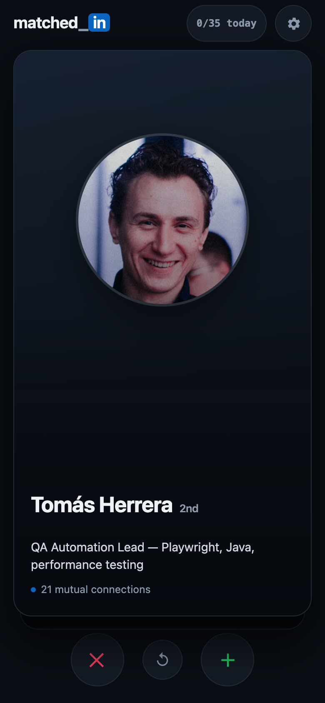
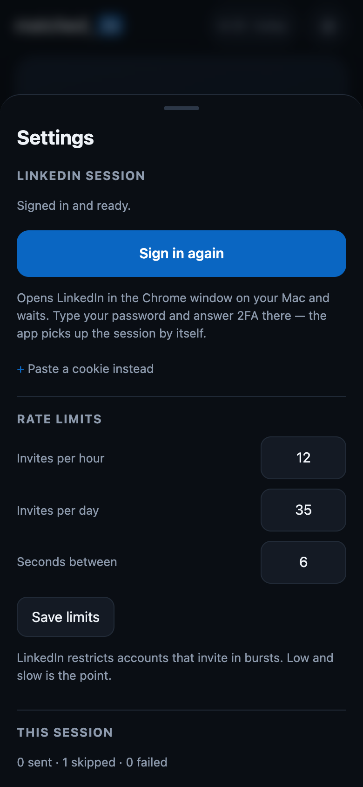

# matched_in

A Tinder-style swipe deck for LinkedIn's connection suggestions, served from your Mac to your phone.

Swipe **right** to send a connection request with no note. Swipe **left** to skip. That is the
whole app — it sends no messages, follows nobody, posts nothing and never edits your profile.

<p>
  
  
</p>

## Read this first

Automating LinkedIn is against its Terms of Service, and LinkedIn restricts accounts that send
invitations in bursts. This is a personal tool for your own account, at a human pace, with low
limits on by default. Use it that way or not at all — a restricted account is a far worse problem
than a slow deck.

It is also a tool that acts on real people. An invitation cannot be unsent, and the undo button
only takes back skips.

## Requirements

- **macOS** with **Google Chrome** (Chromium, Edge and Brave also work; elsewhere set `CHROME_BIN`)
- **Node 22+**
- Your phone and your Mac on the same Wi-Fi

No `npm install`. The project has no dependencies — everything it needs is in Node and the browser.

## Quick start

```bash
git clone https://github.com/StarrLucky/matched_in.git
cd matched_in
npm start
```

The server launches Chrome on a profile of its own (`data/chrome-profile`), separate from the
Chrome you use day to day, and prints two links with an access key:

```
On your iPhone (same Wi-Fi):  http://192.168.x.x:7777/?k=ab12cd34ef56
On this Mac:                  http://localhost:7777/?k=ab12cd34ef56
```

Open either one and tap **Sign in to LinkedIn** (Settings → LinkedIn session). LinkedIn's own login
page opens in that Chrome window on your Mac and the window comes to the front; you type your
password and answer 2FA there. The app watches for the session cookie the login leaves behind and
closes the waiting screen by itself.

**The app never asks for your password and never fills a credential field.** If you would rather
carry a session over from another browser, Settings → *Paste a cookie instead* takes an `li_at`
value directly. Either way the session lives in that Chrome profile, so you do this once.

On the phone, open the link in Safari and use **Share → Add to Home Screen** for a full-screen app
with no browser chrome. The home-screen app starts without the `?k=` part of the link, and iOS gives
it storage of its own, so the first launch asks for the access key — paste the whole link into that
field and it will take the key out of it. Set `SWIPE_KEY` if you would rather the key stopped
changing on every restart.

### Try it without LinkedIn

```bash
npm run demo
```

Fixture profiles, no Chrome, no LinkedIn, nothing sent. This is also what the end-to-end tests run
against.

## Controls

| | |
|---|---|
| Swipe right, `→`, or the green **+** | Send a connection request, with no note |
| Swipe left, `←`, or the red **✕** | Skip — this person will not come back |
| **↺** | Undo the last skip (invites cannot be undone) |
| The quota pill | Opens Settings |

A swipe has to be deliberate: a short, fast twitch is ignored, and the direction that sends
something asks for a longer movement than the skip does.

## How it works

```
iPhone (Safari, or the home-screen app)
        │  http over your Wi-Fi
        ▼
Node server on your Mac  ──CDP──▶  Chrome (its own profile, signed in to LinkedIn)
                                        │
                                        ▼
                               linkedin.com/mynetwork/grow
```

**Why it drives a browser instead of calling an API.** LinkedIn has no public API for "People you
may know" or for sending invitations, and the web app now serves My Network through server-driven
UI — the page talks to `/flagship-web/rsc-action/…` in protobuf blobs tied to server-rendered page
state. The old Voyager JSON endpoints answer `{"status":400}` for suggestions and invites.

So the server reads the rendered page and clicks the real **Connect** button through CDP
`Input.dispatchMouseEvent`, which produces genuine trusted events. Nothing sets
`navigator.webdriver`. When LinkedIn reshuffles its internal APIs again, this keeps working.

**Why the tab is kept "visible".** macOS marks a window sitting behind other windows as occluded,
and Chrome then freezes animation frames in that tab and throttles its timers to one a second —
which is exactly how this app runs, since you swipe from your phone while Chrome sits in the
background. The click would land on the button and LinkedIn's own code would never get a frame to
turn it into an invitation. The driver keeps the tab behaving like the focused, visible one, and
then watches for LinkedIn's answer rather than guessing at a delay.

**Which Chrome it drives.** Only the one it started itself, recorded in `data/chrome-profile.lock`
with its port and pid. If something else holds the debugging port — Brave, Edge, or a Chrome you
started with `--remote-debugging-port` yourself — the server steps over it and takes the next free
port, and says so on startup. Attaching to the wrong browser would mean clicking Connect in a window
you are using.

## Rate limits

**12 invites an hour, 35 a day, 6 seconds apart** by default, all editable in Settings. The server
refuses to go past them; a card that is refused comes back into the deck instead of being lost.

These are deliberately well under LinkedIn's own ceilings.

## What is stored, and who can reach it

Everything lives in `data/`, which is gitignored:

- `state.json` — swipe history (so nobody reappears), your settings, invite timestamps
- `chrome-profile/` — the Chrome profile holding the LinkedIn session

The `li_at` cookie is never written to `state.json`; it stays in Chrome's own cookie store. Nothing
is sent anywhere except to LinkedIn, from your own browser.

The server binds `0.0.0.0` so your phone can reach it, which also means anyone on the same Wi-Fi
could. Every `/api/*` call needs the access key from the printed link, and the app keeps it in
`localStorage` after the first load. This is a key, not a login: treat the link like a password, and
don't run this on a network you don't trust.

## Configuration

| Variable | Default | Meaning |
|---|---|---|
| `PORT` | `7777` | HTTP port for the app |
| `CDP_PORT` | `9222` | First debugging port to try; busy ports are skipped |
| `SWIPE_KEY` | random | Access key; random on every start unless you set it |
| `CHROME_BIN` | auto | Path to Chrome/Chromium/Edge/Brave |
| `DATA_DIR` | `./data` | Where the profile and the history live |
| `DEMO` | — | `1` for fixture mode |

## Development

```bash
make          # lint, unit tests, end-to-end tests
make help     # everything you can run
```

| | |
|---|---|
| `make lint` | A dependency-free linter: every file parses, house rules hold, and the snippets that run inside the LinkedIn page compile — those live in template strings, so no parser would otherwise see them |
| `make unit` | The throttling in the store and the driver's decisions, with the page faked out |
| `make e2e` | The server over real HTTP in demo mode, and the app in headless Chrome — down to a real drag on a card |
| `make demo` | The app on fixture profiles |
| `make clean` | Throwaway profiles the tests leave behind |

Nothing in the suite touches LinkedIn or your session: the tests get their own `DATA_DIR` and their
own Chrome profile, and demo mode never opens LinkedIn at all.

```
server/
  server.mjs    HTTP API and static files
  chrome.mjs    launches Chrome, talks CDP, keeps the tab awake
  linkedin.mjs  everything that knows about LinkedIn's DOM
  store.mjs     history, settings, rate limiting
public/         the app itself — one HTML file, one stylesheet, one script
test/           unit and end-to-end suites
```

## Troubleshooting

**The phone says "Access key needed" or "Wrong access key."** The home-screen app launches without
the key and has storage of its own. Paste the whole printed link into the field. Set `SWIPE_KEY` to
stop the key changing on every restart.

**"A Chrome is already using …/data/chrome-profile."** A window with that profile is open outside
the server's knowledge. Quit it and start again.

**The deck says LinkedIn is not signed in.** Tap **Sign in to LinkedIn** in Settings. If that Chrome
window was quit, the next start opens a new one.

**An invite reports "LinkedIn asked for something this app will not answer."** LinkedIn wanted a
note or an email address for that person. The app only ever takes the "send without a note" path and
refuses the rest rather than filling anything in.

**The deck empties.** Suggestions come from `linkedin.com/mynetwork/grow`. When LinkedIn runs out,
there is nothing to show until it refreshes.

**Nothing works while the Mac is asleep.** The Mac has to stay awake with that Chrome window open —
the phone is only a screen for it.

## License

MIT — see [LICENSE](LICENSE). It covers this code only: what you do with LinkedIn is between you
and LinkedIn.

## Limitations

- macOS-first. The Chrome lookup covers the usual macOS paths; elsewhere, set `CHROME_BIN` — untested.
- It reads LinkedIn's rendered page, so a redesign can break the card parsing. `make lint` compiles
  the page snippets, but only the real site can tell you whether the selectors still match.
- One account, one deck, one machine. There is no multi-user anything here.
